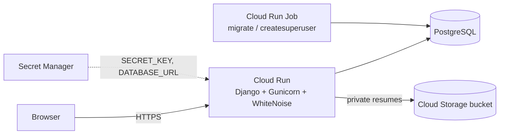

# JobPortal

A full-stack job board built with Django. Employers post jobs and review
applicants; job seekers search, apply with a resume and track their
application status.

**Live demo:** https://jobportal-534831126239.us-central1.run.app/

<!--
Add screenshots after deploying, e.g.:


-->

## Features

**Job seekers**
- Search jobs by keyword (title, company, description) and location, with pagination
- Apply with a resume upload (PDF/DOC/DOCX, max 5 MB) and an optional cover letter
- Track each application's status: Applied → Reviewed → Shortlisted → Hired / Rejected

**Employers**
- Post and edit job listings
- Dashboard of their postings with applicant counts and "new" badges
- Applicants page per job: filter by status, read cover letters, download resumes, update status

**Platform**
- Role-based access control (employer vs. job seeker) enforced on every view
- Resumes are private: they're streamed through a permission-checked view, so only the
  applicant and the job's employer can open them, both locally and in the cloud bucket
- Responsive UI built with plain HTML/CSS (no framework)

## Tech stack

| Layer | Technology |
|---|---|
| Backend | Python, Django 5.2 |
| Database | PostgreSQL (production), SQLite (local) |
| File storage | Google Cloud Storage via `django-storages` (production), local disk (dev) |
| Static files | WhiteNoise (compressed, cache-busted) |
| Server | Gunicorn in Docker |
| Hosting | Google Cloud Run, Secret Manager, Cloud Run Jobs |
| Testing | pytest, pytest-django, pytest-cov |

## Architecture



## Running locally

Requires Python 3.10+.

```bash
git clone <your-repo-url> job_portal
cd job_portal
python3 -m venv env_jobportal
source env_jobportal/bin/activate
pip install -r requirements-dev.txt

cp .env.example .env
# put a real SECRET_KEY in .env:
python -c "from django.core.management.utils import get_random_secret_key; print(get_random_secret_key())"

python manage.py migrate
python manage.py createsuperuser
python manage.py runserver
```

Open <http://127.0.0.1:8000>. Sign up once as an **Employer** and once as a
**Job Seeker** to try both sides.

### Docker

The [`Dockerfile`](Dockerfile) builds the production image used on Cloud Run
(Python 3.12, Gunicorn, non-root user, static files collected at build time).
It expects a PostgreSQL `DATABASE_URL`, since the container's filesystem is
read-only for the app user and is wiped on every restart.

## Tests

```bash
pytest                                   # run the suite
pytest --cov --cov-report=term-missing   # with coverage
```

74 tests cover models, validation, search and pagination, the apply and
status workflow, resume access control and role-based permissions. All
application code has 100% line coverage.

## Configuration

All settings come from environment variables (see [`.env.example`](.env.example)):

| Variable | Purpose | Default |
|---|---|---|
| `SECRET_KEY` | Django secret key | required |
| `DEBUG` | Debug mode | `False` |
| `ALLOWED_HOSTS` | Comma-separated hostnames | `localhost,127.0.0.1` |
| `CSRF_TRUSTED_ORIGINS` | Full `https://` origins in production | empty |
| `DATABASE_URL` | PostgreSQL URL | SQLite file |
| `GS_BUCKET_NAME` | Cloud Storage bucket for resumes | local `media/` folder |

## Deployment

See [DEPLOY.md](DEPLOY.md) for step-by-step deployment to Google Cloud Run.

## Project structure

```
accounts/          Custom user model (employer / job seeker role), sign up, log in
jobs/
  models.py        Job, Application (resume, cover letter, status)
  views.py         Listing, search, apply, applicants, status updates, resume download
  mixins.py        Role-based access mixins and decorators
  templates/jobs/  Page templates
  static/jobs/     Stylesheet
  tests/           pytest suite
jobportal/         Settings, URLs, WSGI
Dockerfile         Production image (Python 3.12, Gunicorn, non-root user)
```
